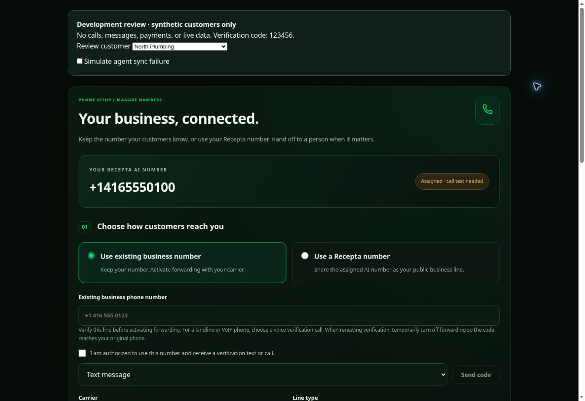
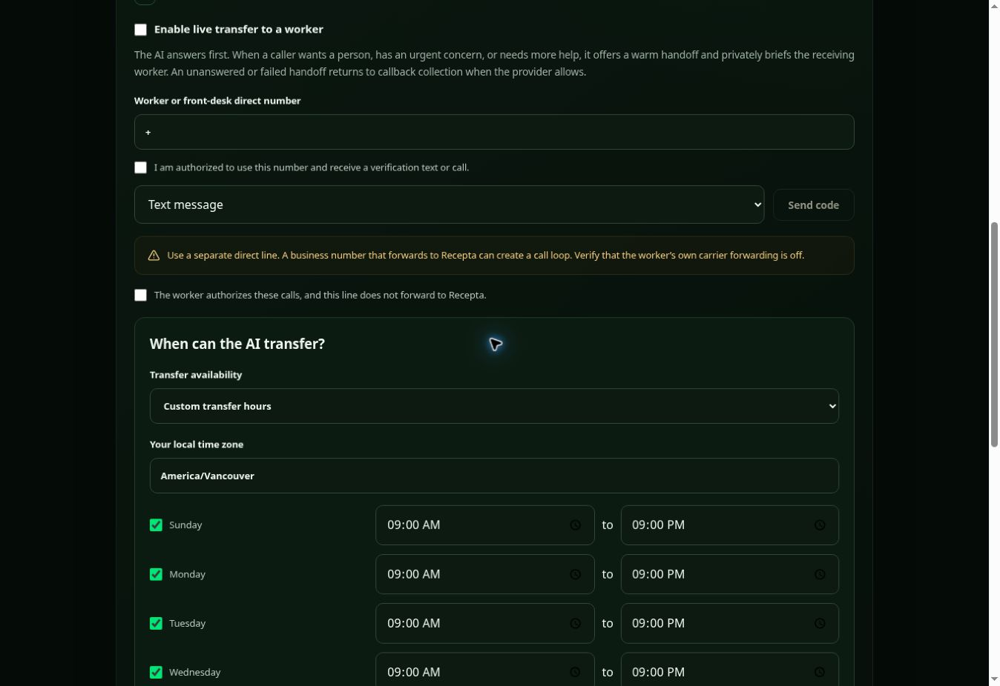

# Phone setup and human handoff — staged release

This extends draft PR #23 on `feature/existing-number-onboarding`. It is **not approved for production**. No live number was purchased, no agent was created, no customer resource was reassigned, and no real verification text/call or transfer test was made during implementation.

## Platform-wide customer onboarding

This is one shared product feature for **every current and future Recepta customer**. It does not contain a special route or fallback for the founder's agent. Each authenticated customer loads only their own account, assigned numbers, verified business/worker lines, settings and call outcomes. New accounts start with transfers disabled and acquire their own settings on first save; no per-customer code or deployment is required.

Each customer must have a dedicated agent in Recepta's managed Retell workspace. Admin creation, reassignment and editing reject an agent owned by a different customer before changing accounts or contacting Retell. The staged migration enforces unique provider-agent and primary-number assignments, including concurrent requests. Existing duplicate assignments must be resolved before the migration can pass; it never moves them silently.

Number provisioning reuses the existing authorized Checkout/payment-webhook workflow. A newly configured customer can continue from Phone Setup to Billing and receive the included first AI number after confirmed payment. Choosing either dashboard option alone never buys a number. A previously assigned number is reused, and verified payment replays cannot purchase it again. Verified-email customer signup now initializes a pending Standard or Pro account with the GPT-4.1 catalog model and 300 editable monthly minutes. With automatic fulfillment configured, confirmed paid Checkout creates a dedicated agent/LLM from an approved generic template and provisions the included first number; existing assigned resources are reused. Routine agent assignment, forwarding setup and worker-number changes do not need a per-customer code change or support call. Ambiguous provider creation failures require exceptional reconciliation rather than a duplicate purchase.

## Customer experience

The Agent page has one Phone Setup / Manage Numbers section. Customers can use their assigned Recepta number publicly or retain a carrier number and activate forwarding themselves. Mobile, landline and compatible hosted VoIP services are supported when the carrier supports forwarding. Saving a number does not activate carrier forwarding.

Owners verify existing business and worker numbers using a provider-issued code. Worker changes are self-service, with an authorization/no-forwarding declaration each time transfers are enabled. The first release allows standard US/Canadian direct destinations; it rejects other NANP countries, toll-free, premium, extensions and SIP destinations. The destination table allows additional labeled destinations later; only the primary destination is exposed now.

Owners can renew verification of their own original business line after it expires. A historical forwarding source still cannot become a transfer destination or be claimed by another account. Forwarding must be temporarily deactivated when receiving a renewal code on that original line. Invalid number input returns an actionable 400 response and never contacts a provider.

A dedicated worker line is required. The same phone cannot forward every call to AI and receive the AI's transfer without a separate direct line. Actual carrier rules, forwarding charges and voicemail behavior must be checked by the owner.

## Server configuration

Use an isolated Netlify test environment and isolated Supabase test database first. Do not turn this on in a preview that uses production customer data or production Retell resources for automated tests.

Existing server-only configuration:

- `SUPABASE_URL`, `SUPABASE_SECRET_KEY`, `RETELL_API_KEY`, `ADMIN_EMAIL`.
- `RECEPTA_APP_URL` must be the externally reachable URL of the intended test deployment. Number routing uses this URL, falling back to Netlify `URL`. Set it explicitly in the test environment so a production value is not inherited.
- `RECEPTA_REQUIRE_STRIPE_TEST_MODE=true` selects `STRIPE_STAGING_SECRET_KEY` across Checkout, webhooks, customer creation, the billing portal, reminders and cleanup. Non-production Netlify contexts also use this dedicated test key. Production reads `STRIPE_SECRET_KEY`. Store the sandbox signing secret in the branch override of `STRIPE_WEBHOOK_SECRET`. Staging accepts only signed events with `livemode: false`.

New configuration:

- `RECEPTA_PHONE_SETUP_ENABLED=true` enables the staged endpoints and runtime destination resolution. Leave it unset/false outside the isolated test environment until the release gates below pass. Turning it off prevents destinations from being supplied for new calls.
- `TWILIO_ACCOUNT_SID` and `TWILIO_AUTH_TOKEN` are existing server-side Twilio settings.
- `TWILIO_VERIFY_SERVICE_SID` is a Twilio Verify service SID (`VA…`). Configure SMS/voice verification and appropriate geographic/fraud controls in that service. This is separate from an SMS sender number. No number purchase is necessary to implement the Verify integration. Verify usage incurs provider charges when users explicitly request codes.

Never put these credentials in `VITE_*`, source files, browser storage or PR comments. The browser never receives provider secrets or Twilio challenge SIDs/codes from the server. The separate reception-test code is intentionally displayed to the owner and stored hashed. Codes are sent directly to the verification provider for checking and are not stored by Recepta.

## Database

The staged migrations are the phone-setup migration and the three `20261105` follow-ups for a unique customer agent, transfer schedules/call evidence, and paid provisioning. Fresh empty staging projects use [the isolated schema baseline](../supabase/staging/README.md). It has been executed against synthetic PGlite PostgreSQL fixtures; **it has not been applied to production**.

All new tables have RLS and service-role-only grants/policies. Authenticated customers access them only through verified-session Netlify handlers, scoped to `user.id`. Editable Auth `user_metadata` is not an authority for destinations, verification or billing. No existing customer metadata flags are trusted or migrated as verified numbers.

Tables: `phone_setups`, `phone_verified_numbers`, `phone_transfer_destinations`, `phone_forwarding_sources`, `phone_operation_limits`, `phone_operation_locks`, `retell_agent_sync_locks`, `call_transfer_events`, `phone_reception_tests`, `phone_provisioning`. Client-linked rows cascade on account deletion. Limits contain hashed keys; their storage is bounded by paid account/verification usage, and expired counter rows can be periodically pruned by operations.

Settings use a revision and a per-account mutation lease. A durable pending state is saved before publishing to Retell. New inbound calls receive no destination while sync is pending or failed. A failure to mark publication successful also leaves transfers disabled. The owner can retry Save & Sync. Disabling transfers works after payment/verification expires or an agent is removed.

A shared agent-publication lease serializes transfer, hours, employee and subscription agent-version publishers when this feature is enabled. It is acquired before loading/cloning the published version. Busy updates return an error for a later retry, rather than publishing an older tool list. Provider failures release the lease; interrupted instances expire after 15 minutes. Changes made directly in Retell outside Recepta are not covered by this lock.

## Existing purchased number association

No account association is inferred from an agent ID, phone number, business name or chat identity. Before any write, Admin → Edit Client → **Link an already purchased number**:

1. Select the correct existing customer account and review its email.
2. Enter the existing agent ID and purchased number.
3. Confirm ownership/authorization.
4. The server verifies the selected client is available, its contact email matches a confirmed Auth login, the provider resources exist in Recepta's Retell workspace, the number is not bound to a different agent, and conflicting database assignments do not exist.
5. The atomic link preserves existing agent prompts/settings and never activates a subscription. It cannot replace a different assigned agent or add unpaid additional numbers. Number routing is switched to Recepta's admission webhook with no static inbound agent fallback.

The supplied production pair was checked again read-only on 2026-11-03. It now has a matching `agents` association to an available Recepta customer whose contact email matches a confirmed Auth login. The subscription is pending. The Retell workspace/agent access was also verified in the preceding connection repair. No assignment write or billing activation is needed or performed by this PR; a real paid reception test remains open.

If a provider routing update fails after assignment, the endpoint reports the partial result and can be retried. Do not mark service live based on the assignment alone. Normal billing/activation and real reception tests remain required. New numbers continue through the existing quote, authorized Checkout, verified payment webhook and provisioning workflow; this PR does not add an unapproved purchase path or new pricing.

## Transfer behavior and limits

The AI answers first. Its managed native Retell `transfer_call` tool uses `warm_transfer`, a 25-second ring period, human detection and a private brief. It offers a transfer for an explicit human request, unresolved issue or urgent concern, asks for consent, and otherwise collects callback details. Immediate safety emergencies are directed to emergency services. The prompt requests at most one handoff attempt per call. The native provider handles the call leg; successful bridging is recorded only from `transfer_bridged`.

The tool's destination is a dynamic variable with an empty default. Only signed inbound admission supplies a verified direct line after checking paid entitlement, dedicated agent, successful sync and loop safety. New calls to an inactive account remain subject to existing minute reservation/activation rules. Already admitted calls retain the settings and paid reservation they started with; disabling applies to new calls.

The worker sees the Recepta AI number, avoiding unsupported caller-ID spoofing. Known AI numbers and all known current/historical forwarding sources are blocked as destinations. A new inbound call whose caller ID is a known Recepta number is rejected before reserving minutes, which stops the usual worker-forwarding-back loop. Unknown carrier forwarding, hidden caller IDs, PBX rewrites or future carrier changes cannot be proven absent by entering a number. Owners must keep the receiving line direct and run the loop/voicemail tests. Historical sources are conservatively retained as unsafe transfer destinations.

Warm transfer cannot be tested with browser audio. Human detection and voicemail behavior depend on the receiving network; they must be tested with the actual worker line. This release uses ordinary warm transfer, not a separate agentic transfer agent. It does not promise a two-way staff acceptance/rejection conversation. A worker hanging up, voicemail or a carrier error must be checked in real calls; do not market guaranteed transfer behavior until these pass.

Transfer sync sets Recepta’s call-event webhook, always subscribes to the existing call lifecycle events plus transfer events, and retains other subscribed events. An agent with a different existing event webhook requires review rather than silently replacing it. Retell transfer webhooks are signature-verified, account-resolved and persisted idempotently. Sparse events fetch the canonical call for ownership. They never update the call lifecycle, duration, minutes, appointments or owner-email delivery state. Calls shows a confirmed handoff only when a bridged event exists; started/ended events alone are not proof. Repeated identically shaped events are deduplicated; the UI does not advertise precise attempt counts. Missing webhook delivery can leave an outcome unknown. Transfers may add carrier/provider leg charges, separate from the existing AI-minute calculation.

## Carrier guides

Guides were checked against carrier-owned documentation on 2026-11-02. They distinguish Rogers mobile, Bell Mobility, TELUS mobile, Rogers Home Phone, TELUS Office Phone and general PBX/other providers. They include source links, carrier activation, deactivation and plan/voicemail caveats. No universal code is advertised for unknown VoIP or landline services.

- https://www.rogers.com/support/mobility/use-call-forwarding
- https://www.rogers.com/support/home-phone/call-forwarding
- https://support.bell.ca/mobility/rate_plans_features/how_to_use_call_forwarding_on_my_mobile_phone
- https://www.telus.com/en/support/article/call-forward-mobile
- https://www.telus.com/en/business/support/article/use-call-forwarding-variable
- https://docs.retellai.com/build/single-multi-prompt/transfer-call
- https://docs.retellai.com/api-references/update-retell-llm
- https://docs.retellai.com/features/webhook-overview
- https://www.twilio.com/docs/verify/api/verification
- https://www.twilio.com/docs/verify/api/verification-check

Cancellation does not deactivate carrier forwarding. The owner must undo it with the carrier, verify their original line and voicemail, and handle subscription cancellation separately. Incompatible or missing numbers are not labeled connected. Reception is confirmed only by a signed custom-function request from an admitted, ongoing incoming phone call, validated against the canonical provider call and a short-lived dashboard test code for the current setup revision. Legacy browser-reported reception dates are not used. The original dialed carrier number is not always exposed, so the UI distinguishes AI reception evidence from carrier activation. Handoff test confirmations remain customer-reported; individual call outcomes still require bridge events.

## Automated verification

`npm run test:phone` runs real authenticated handlers against synthetic PostgreSQL tables/functions and mocked Retell/Twilio APIs. Coverage includes tenant ownership, billing expiry, verification/consent, target/attempt limits, persistence, stale revisions, overlapping publication, provider/storage failure, disabling without an agent, known loops, destination country/tariff restrictions, resource linking, signed sparse/out-of-order transfer events, and preservation of other tools/hours/appointment instructions. No production calls, messages, payments or database writes are used.

Additional regressions exercise two independently onboarded paid customers, different provider agents/LLMs/destinations, disabling one customer without affecting the other, unique assignment races, all three admin assignment routes, renewal of business verification, an empty successful Retell publish response, and first-number fulfillment only after verified payment.

Validation on 2026-11-03: **139 automated tests passed**, along with ESLint, the production build and backend TypeScript checks for the phone, call-record and admin assignment handlers. The build retains existing dependency/chunk-size warnings.

For repeatable browser QA, start the Vite development preview and open `/tests/ui/phone-setup.html`. This development-only fixture uses the real React component with synthetic North Plumbing, South Heating and a new unpaid account; code `123456` verifies a fixture number. It has no Auth session, provider requests, messages, calls, payments or live database connection, and is excluded from Vite's production input. `/tests/ui/phone-setup.mobile.html` embeds it in a real 360px viewport. Browser checks passed for verification failure/success, switching customers with separate settings, sync failure/retry, unpaid restrictions and the 360px layout with no overflowing controls. These are not live telephony tests.

## Release gates — all real-call rows remain open

| Gate | Evidence needed |
| --- | --- |
| Isolated test migration/configuration | All staged schema/catalog SQL installed and hosted RLS/grants verified; isolated Netlify deployment and secure provider configuration remain blocked on account access. |
| Exact account association | Supplied pair now verified read-only against the assigned customer's confirmed login; billing remains pending. Review any future customer's ownership before assignment. |
| Paid reception | Call the assigned number; correct AI answers; no default provider binding bypasses admission. |
| Carrier forwarding | Activate with the actual business carrier; call original number from another phone. |
| Successful handoff | Worker hears private brief; both parties can speak; bridge event appears in Calls. |
| Unanswered/rejected/voicemail | AI collects callback details where supported; never claims connection without a bridge. |
| Loop safety | Try same AI/business destination (must reject); controlled worker-forwarding-back test must not loop. |
| Payment/minutes | Unpaid/expired/exhausted accounts cannot admit new calls; paid calls beyond three minutes and demos retain existing limits. |
| Existing workflows | Pending appointment request, owner email delivery/retry, signed call records and admin hours still work in real calls. |
| Cancellation | Pages stay visible; disable transfer works; carrier forwarding is manually removed and tested. |

The pre-existing buyer appointment email/SMS acknowledgement gap is outside this phone-management change. Do not advertise caller confirmations as finished solely because a verification text is working.

Keep PR #23 draft and unmerged until these gates are reviewed. No production telephony deployment is authorized by this implementation request.

## Transfer schedules, callback requests and real-call reception evidence

Customers choose 24/7, existing business hours, or custom daily transfer hours and
an IANA time zone. Custom hours support overnight windows and a 21:00 cutoff.
Business-hours mode reads the admin-managed schedule and its time zone; missing
hours fail closed. Saving does not edit store hours, answering hours or billing.
The schedule is durable under the same revision, mutation lease and successful
Retell publication as the destination. Other publishers preserve managed tools.

The server supplies no native transfer destination outside the permitted window.
Retell's native transfer tool has no per-attempt authorization hook in this agent
integration, so admission checks **the entire enforced maximum call lifetime plus a one-minute provider setup margin**.
Calls that could cross the cutoff use callbacks from the beginning; they are not
cut short. For example, a two-hour admitted call window with a 21:00 cutoff stops
offering transfers by 19:00. This conservative behavior is visible in the UI.
Changes apply to new calls; ongoing calls keep their originally admitted window.
Direct provider edits, shared external tools and caller-supplied destinations must
not bypass Recepta admission. Existing state-specific transfer routes are rejected
for review, not silently removed. Retell LLM ownership is indexed separately from
agent ownership; a shared LLM blocks all managed agent publishers.

The managed callback tool collects caller name, confirmed phone, reason and
preferred callback time. Signed requests resolve the canonical incoming call and
its assigned account, never a model-supplied customer ID. The server saves details
and queues one job in the existing callback notification workflow. Calls displays
human follow-ups alongside missed calls. Answered AI callbacks use normal minutes;
only declined calls retain the no-minutes notice. Email failure remains retryable.

The reception code is separate from Twilio number verification. It is generated
in the dashboard, stored hashed for ten minutes, and must be spoken to the AI in
a new incoming call. The server checks signature, provider call type/direction,
active call state, paid account, assigned inbound line, dedicated agent, admission
metadata, call start time, code and unchanged setup revision. Only that result sets
`reception_observed_at`. A browser checkbox, routing configuration, SMS approval,
outbound/web call, old code or another customer's call cannot confirm reception.

Loop checks normalize legacy formatted numbers as well as current E.164 values.
Known AI numbers and historical forwarding sources are rejected even when saving
a disabled destination and are checked again on each new call. Hidden carrier
rules still require an authorized real-world test.

Validation on 2026-11-05 UTC: **157 regression tests passed**, followed by **52
focused checks** after the last normalized loop-admission update. ESLint, backend
TypeScript and the production build passed; existing chunk-size/dependency
advisories remain. Browser QA verified custom hours and time-zone persistence,
separate customer defaults, and a 360px layout with zero overflowing controls.
[Staging installation evidence and deployment boundary](../supabase/staging/README.md).
No actual carrier forwarding or live human transfer is certified by these tests.

## Self-service completion update

### Implemented in the development branch

- Customer signup and email confirmation initialize a pending account, receptionist row and server-priced Standard or Pro plan atomically. Repeated initialization preserves the existing account. GPT-4.1 is the initial model, with 300 monthly minutes editable in Billing.
- Dashboard Overview links directly to Phone Setup. Phone Setup displays the assigned agent and every assigned number, verification state, sync state and reception-test evidence. Save results distinguish a completed write from a failed refresh.
- Billing lets customers choose Canada or the US and add number allowances at C$20 per additional number per month. The existing included-number workflow assigns available digits through Retell after paid authorization.
- A configured Twilio trunk additionally enables exact local-number search and selection. Searches are read-only and filtered for voice capability. The customer confirms the chosen number and monthly cost, and availability is rechecked before Checkout. One exact number is supported per Checkout. Search results are not reservations.
- The signed live-payment handler purchases the exact number through Twilio, connects the configured trunk, verifies the returned account/trunk/number identity, journals the provider SID and imports the number into Retell using the same paid-admission webhook. It validates an existing import before reusing it. Staging blocks actual purchases.
- Identical Checkout requests share a deterministic Stripe idempotency key. Both manually assigned and automatically created agents use the customer provisioning lock and purchase journal. Ambiguous purchase/import outcomes stop for review.
- Cleanup and cancellation preserve underlying agents and phone numbers. Cancellation pauses service and keeps the local assignment. Customer deletion detaches routing and removes local account records after existing billing/call cleanup. Legacy orphan-number jobs are quarantined for review. Account deletion is blocked while a creation/purchase/import remains unresolved.
- Server-only phone audit records survive account deletion. Browser roles cannot read or write this ledger or call the customer initialization RPC.
- Every preview Retell operation requires an explicit staging key. Inherited production Retell credentials are excluded. Twilio staging verification additionally requires the target to be allowlisted.
- Admin Operations has a read-only phone-provider readiness check. It validates the configured Verify service/account through Twilio and reports credential/configuration status without returning secrets.

### Required one-time configuration

Scope the following values to the development branch in Netlify. Preserve production values.

| Setting | Purpose |
| --- | --- |
| `RECEPTA_PHONE_SETUP_ENABLED=true` | Expose phone setup and verified-email onboarding |
| `RECEPTA_REQUIRE_STRIPE_TEST_MODE=true` | Enforce the Stripe sandbox boundary |
| `RETELL_STAGING_API_KEY` | Dedicated isolated Retell workspace used by every preview provider operation |
| `TWILIO_ACCOUNT_SID`, `TWILIO_AUTH_TOKEN`, `TWILIO_VERIFY_SERVICE_SID` | Staging Verify credentials and approved service |
| `RECEPTA_STAGING_VERIFY_TARGETS` | Comma-separated approved E.164 staging verification destinations |
| `STRIPE_STAGING_SECRET_KEY`, `STRIPE_WEBHOOK_SECRET` | Sandbox Checkout and signed webhook delivery |
| `RECEPTA_AUTO_PROVISION_ENABLED`, `RETELL_ONBOARDING_TEMPLATE_AGENT_ID` | Approved generic, unassigned Retell LLM template and automatic fulfillment gate |
| `RECEPTA_TWILIO_NUMBERS_ENABLED=true` | Enable exact-number search once its trunk is configured |
| `TWILIO_TRUNK_SID`, `TWILIO_TERMINATION_URI` | Dedicated Elastic SIP trunk and its `*.pstn.twilio.com` termination hostname |
| `TWILIO_TRUNK_USERNAME`, `TWILIO_TRUNK_PASSWORD` | Dedicated trunk authentication credentials |

Configure the Twilio trunk's origination route, authentication and termination permissions using the provider guide before enabling exact-number fulfillment. The code attaches purchased numbers to that trunk. Verify both inbound routing and warm transfer on the actual trunk.

Supabase Auth must allow customer signup, email confirmation and the preview login redirect, with working confirmation-mail delivery. The existing verified staging login is preserved.

Apply `20261107004145_self_service_phone_onboarding.sql` and `20261107051800_selected_twilio_numbers.sql` after the existing feature migrations. Both self-service migrations were applied on `mvufjeqxqvpcfqwmihpy`. Hosted read-only checks verified the initialization RPC permissions, audit visibility and unfinished-provisioning guard. The rollback-only hosted onboarding fixture did not execute because its confirmation expired. Local PostgreSQL tests exercise atomic initialization and audit retention.

### Remaining release gates and operating limits

Real SMS/voice verification, carrier forwarding, incoming audio, staff briefing, successful/rejected/busy/unanswered transfer, voicemail detection, fallback and loop tests require approved test numbers and a controlled test window. Automated tests use synthetic provider responses. The exact-number purchase/import flow has not bought or imported a real number.

Provider inventory can change after payment. An unavailable number or uncertain purchase/import preserves the journal for reconciliation. A paid order that cannot be fulfilled requires selecting a replacement with authorization or a billing remedy. The implementation preserves provider resources during that review.

Transfer schedules use the existing conservative admission window. With a two-hour call limit and a one-minute setup margin, a 21:00 cutoff stops offering transfers near 18:59. This protects after-hours restrictions and must be explained during onboarding.

Retained provider numbers can continue to incur provider charges after a Recepta subscription is cancelled. Permanent agent deletion and number release are handled separately in the provider dashboard with explicit owner authorization. Recepta exposes no automatic agent-delete or number-release endpoint.

Netlify sign-in is required to verify branch-scoped runtime credentials and use the readiness check with a staging admin login. The current Netlify browser session is signed out. Supabase's staging security advisor also reports leaked-password protection disabled. Evaluate Auth password protections before launch.

### Provider references

- [Twilio available-number search](https://www.twilio.com/docs/phone-numbers/api/availablephonenumberlocal-resource)
- [Twilio purchase and trunk attachment](https://www.twilio.com/docs/phone-numbers/api/incomingphonenumber-resource)
- [Retell Twilio Elastic SIP setup](https://docs.retellai.com/deploy/twilio)
- [Retell import API](https://docs.retellai.com/api-references/import-phone-number)
- [Twilio Verify service inspection](https://www.twilio.com/docs/verify/api/service)
